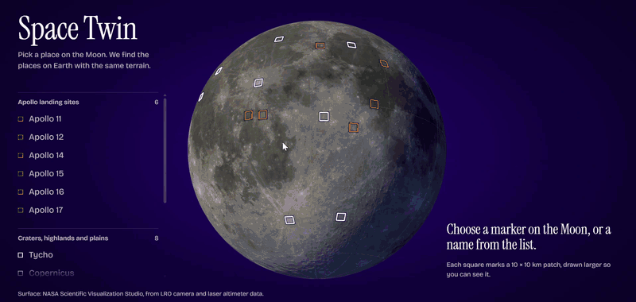

# 🌕 moon-analog-lite

A lightweight, explainable **Earth–Moon analog discovery tool** for the **2026 NASA Space Apps Challenge**
([Identify Earth Locations that Analog the Permanent Moon Base Locations and Mars](https://www.spaceappschallenge.org/2026/challenges/permanent-moon-base-locations-and-mars/?tab=resources)).

**Given a location on the Moon, which places on Earth are analogous to it, in which respects, and where does the analogy break down?**

The challenge accepts that an Earth analog need not match the Moon in every respect. It asks which
dimensions (terrain, temperature, illumination, ...) are analogous and where they are not. So the tool does
not produce one opaque "Moon-likeness" number. It scores each dimension separately and combines them with
user-adjustable weights. A result can read: *strong terrain analog, moderate thermal analog, poor
illumination analog*.



The terrain comparison is the core. Both bodies are reduced to the same representation:

```text
 Earth DEM (NASADEM / Copernicus)      Moon DEM (LRO LOLA 118 m)
              │                                   │
        10 km patch, 85 x 85 grid          10 km patch, 85 x 85 grid
              │                                   │
        12 terrain features                12 terrain features
              └──────────────┬────────────────────┘
                     similarity engine  ◄── optional: thermal range, solar illumination
                             │
                  ranked Earth analogs ──► CLI · HTTP API · Streamlit
```

The ranking measures similarity of selected, measurable features. It is **not** a statement about
landing-site suitability, mission safety or geological equivalence, and Earth cannot reproduce lunar vacuum,
gravity, radiation, day length or the exact thermal regime.

- Event: https://www.spaceappschallenge.org/2026/local-events/poznan
- Data resources: https://www.spaceappschallenge.org/2026/challenges/permanent-moon-base-locations-and-mars/?tab=resources
- Judging criteria: https://www.spaceappschallenge.org/resources/judging-awards-guide/

---

## Features

1. **Terrain (12 features per patch)** — computed by the same function for both bodies
(`src/morphometry.py::extract_patch_features`):

- slope percentiles: `slope_p05, p10, p25, p50, p75, p90, p95`
- shape: `rms_height`, `tri_mean`, `relief_range`, `hypsometric_integral`, `elev_skew`

`log1p` is applied to `rms_height`, `tri_mean` and `relief_range`, then all features are z-scored with the
Earth index statistics. Terrain distance = `w_slope · slope RMS + (1 - w_slope) · shape RMS` of the z-score
differences (smaller = more similar). Moon features outside the Earth range (|z| > 3) are flagged.

2. **Thermal range** (optional, experimental): `thermal_range_percentile`, how thermally variable a patch is
relative to other patches of its own body.

3. **Solar illumination** (optional, experimental):
`solar_visibility_fraction`, the share of time the Sun is above the terrain horizon.

4. **Mafic–felsic composition proxy** (optional, experimental, opt-in): `mafic_felsic_percentile`
(0 = relatively felsic / anorthositic, 1 = relatively mafic / basaltic within its own body). Earth: ASTER GED
thermal-infrared emissivity ratio; Moon: Diviner Christiansen Feature wavelength. It is a coarse proxy, not
mineral or chemical equality, and the Moon polar sites (beyond ±70°) have no value.

5. **Practicality** (separate from similarity, opt-in): how hard, expensive and disruptive a simulation would be at an
Earth patch. It answers a different question from the analog score and **never changes it**: a site is not
ranked higher because it is cheap or accessible. Details in [`docs/practicality.md`](docs/practicality.md).

- **Group A, cost drivers (0-100 scores, higher = easier/cheaper):** `access_score` (travel time to cities, airports,
  major roads), `buildability_score` (best ~1 x 1 km facility core inside the patch + bare-ground fraction),
  `emergency_support_score` (travel time to healthcare), `infrastructure_score` (distance to high-voltage lines),
  `population_score`.
- **Group B, intrinsic constraints (flags, not scores):** protected areas, World Heritage, community/land rights,
  biodiversity, water stress, volcanic hazard, security. Each is `ok | warning | manual_review | excluded | missing`;
  any `excluded` makes the site `hard_excluded` (class `EXCLUDED / MANUAL REVIEW`, not "Very High").
- **Population** gives two separate penalties: `isolation_logistics_penalty` (few people nearby) and
  `population_impact_penalty` (many people nearby).
- **Two profiles:** `field_campaign_score` (short rover/instrument campaigns: access and emergency matter most) and
  `facility_score` (repeated campaigns, habitats: infrastructure and buildability matter most), each with a relative
  cost class `LOW / MEDIUM / HIGH / VERY HIGH` (>= 75 / 50 / 25 / below).
- Missing data is never zero: scores are renormalised over the available dimensions and
  `practicality_completeness` / `practicality_confidence` say how complete they are.

All optional features live in side
tables keyed by `patch_id`, so the strict 17-column index CSVs ([`docs/CONTRACT.md`](docs/CONTRACT.md)) are
unchanged and terrain-only queries keep working.

### How scoring works (overview)

Two questions are answered separately and never merged into one number.

**1. Scientific similarity (decides the ranking).** `total_distance` (smaller = more similar) is a weighted mean of
component distances. A component with missing data drops out and the weights renormalise; it is never zero.

| Component | Metric | Used in ranking | Weight in the web frontend |
|---|---|---|---|
| Terrain | 12 morphometric features (7 slope percentiles, `rms_height`, `tri_mean`, `relief_range`, `hypsometric_integral`, `elev_skew`), z-scored, RMS | always | 0.6 (the rest) |
| Thermal | day-night surface-temperature swing, percentile within its own body | optional | 0.2 |
| Illumination | `solar_visibility_fraction` (share of time the Sun clears the terrain horizon) | optional | 0.2 |
| Composition | mafic-felsic proxy (ASTER on Earth, Diviner on the Moon; lithology-based fallback on Earth) | opt-in | 0 (shown only) |

The default method is `legacy_percentile`; `physical_hybrid_v1` compares physical values directly where the
measurements are comparable (see [Scoring methods](#scoring-methods)). After scoring, the top K is taken with at most
one patch per region.

**2. Practicality (does not affect the ranking).** Attached on request (`--practicality` / `include_practicality`) as
extra blocks on the same candidates. It never changes `total_distance` or the order.

| Kind | Metric | Meaning |
|---|---|---|
| Cost driver, score 0-100 (higher = easier) | access, buildability, emergency support, infrastructure, population | how hard and expensive it is to run a simulation there |
| Constraint, flag | protected area, World Heritage, community rights, biodiversity, water stress, hazard, security | `ok / warning / manual_review / excluded`; any `excluded` = `hard_excluded` |
| Output | `field_campaign_score`, `facility_score` + cost class `LOW / MEDIUM / HIGH / VERY HIGH` | weighted combination of the scores for short field campaigns or long-term facilities |

**Choosing a site: the Pareto front.** Each candidate is a point (practical score, scientific closeness). A candidate
is Pareto-optimal when no other candidate is both closer and more practical. The web frontend shows this chart
and the CLI plots it with `3b_plot_pareto.py`; see [Practicality and the Pareto front](#practicality-and-the-pareto-front).

### Why these dimensions

A DEM says how a place *looks*, not what conditions it exposes equipment to. Thermal range and illumination
are two operationally relevant dimensions that can be compared consistently for both bodies with openly
available data. They are not the only ones: vacuum, regolith and dust, radiation and gravity can matter just
as much, and are **not** covered here.

- **Thermal range.** The Moon has almost no atmosphere to buffer temperature, so surface temperatures swing
  strongly over the lunar day, and permanently shadowed regions stay extremely cold. Large temperature
  variation drives thermal stress on materials and affects batteries, electronics and mechanisms. Earth
  locations with a large temperature range (hot or polar deserts, high plateaus) can be useful for testing
  *selected aspects* of equipment behaviour under thermal cycling. The feature does not claim that Earth
  reproduces lunar absolute temperatures.
- **Solar illumination.** Sunlight affects power availability, heating and the length of operating windows.
  Near the lunar poles, crater interiors can be permanently shadowed while nearby elevated terrain is lit for
  a much larger share of the time (NASA's LOLA polar products map average illumination and permanent shadow).
  Terrain that looks the same can therefore have very different light conditions. The feature measures how
  much terrain shading limits the Sun, so the ranking can prefer Earth sites with comparable shading.

Because each dimension is scored separately, the tool can show *what* is analogous and *where* the analogy
fails, and a user can weight the dimensions for a given test question (see [Adjusting weights](#adjusting-weights)).
The weights are experiment-dependent settings, not a universal definition of "Moon-like".

Both features are relative or geometric: thermal values are percentiles within each body, and illumination is
geometric Sun visibility without an atmosphere or clouds. They add explainable dimensions to the analog score
and are not proof of environmental equivalence. See the limitations below.

## Datasets

| Feature | Body | Dataset | Used for |
|---|---|---|---|
| **Terrain** | Earth | [NASADEM](https://www.earthdata.nasa.gov/data/catalog/lpcloud-nasadem-hgt-001) (SRTM-derived, 1″ ≈ 30 m, surface model incl. canopy) for 51 regions; [Copernicus DEM GLO-30](https://planetarycomputer.microsoft.com/dataset/cop-dem-glo-30) (30 m) for 8 regions. Tiles come from the Planetary Computer and were cross-checked in `docs/dem_crosscheck.md` | Elevation → 10 km patches → 12 terrain features |
| | Moon | [LRO LOLA global DEM, 118 m/px](https://astrogeology.usgs.gov/search/map/moon_lro_lola_dem_118m) (USGS Astrogeology, simple cylindrical, mostly interpolated between altimeter tracks); optional 20 m south-polar product (`ldem_80s_20m`, [PDS Geosciences](https://pds-geosciences.wustl.edu/missions/lro/lola.htm)) | Elevation → 10 km patches → 12 terrain features |
| **Thermal range** | Earth | [MODIS MOD11A2/MYD11A2 v061](https://lpdaac.usgs.gov/products/mod11a2v061/) land surface temperature (Terra + Aqua, 1 km, 8-day composites, day and night layers + QA flags), read as COGs from the [Planetary Computer](https://planetarycomputer.microsoft.com/dataset/modis-11A2-061); year 2024 | The day–night swing per 8-day period (max − min of up to 4 overpass samples), median over the year |
| | Moon | [LRO Diviner](https://pds-geosciences.wustl.edu/lro/urn-nasa-pds-lro_diviner_derived1/) Global Cumulative Product, `tbol` bolometric temperature (0.5° cells, 96 local-time bins, 2009–2015 average); the 4 south-polar sites use the [Polar Cumulative Product](https://pds-geosciences.wustl.edu/lro/urn-nasa-pds-lro_diviner_derived1/data_derived_pcp/) (240 m, 0.25 h bins, summer and winter, streamed with HTTP range requests) | The hot-vs-cold swing across the lunar day |
| **Composition** | Earth | [ASTER Global Emissivity Dataset AG100.003](https://lpdaac.usgs.gov/products/ag100v003/) (100 m, 2000–2008 clear-sky; bands 10–14, NDVI, land/water map, observation count; **needs a free NASA Earthdata login**) | Mafic Index `e12 / e13` (Quartz Index `e11² / (e10·e12)` only as a confounder flag), patch median over bare land pixels |
| | Moon | [Diviner Christiansen Feature map, viewing- and space-weathering-corrected](https://zenodo.org/records/4558194) (Lucey et al. 2021; 32 pixels/degree, ±70° latitude, no login); the older `DIVGLOB1701_CX3` map is kept only for a comparison table | CF wavelength: higher = more mafic, lower = more felsic / anorthositic. The same record's Diviner plagioclase / pyroxene / olivine rasters give diagnostic fractions |
| | Earth (fallback) | [Macrostrat](https://macrostrat.org/api) geologic-unit API (public, CC-BY 4.0, no login), 3×3 sample points per patch | Categorical lithology and confounder fractions (explanation only, never turned into the percentile) |
| **Practicality** | Earth | [WorldPop 2020 1 km](https://www.worldpop.org/) population; [Malaria Atlas Project](https://malariaatlas.org/) travel time to cities (2015) and to healthcare (2020); [OurAirports](https://ourairports.com/data/); [Natural Earth](https://www.naturalearthdata.com/) major roads; [ESA WorldCover 2021](https://esa-worldcover.org/); OSM power lines via Overpass; [WDPA](https://www.protectedplanet.net/) protected areas; Smithsonian [GVP](https://volcano.si.edu/) Holocene volcanoes (all no login) | Access, buildability, emergency, infrastructure and population scores, constraint flags. Grid distance is OSM for 15 regions and an approximate estimate from general knowledge elsewhere (`grid_source = estimated`) |
| **Solar illumination** | Earth | NASADEM / Copernicus DEM (terrain horizon, as above) + [pvlib](https://pvlib-python.readthedocs.io/) solar position (NREL SPA), hourly 2024 | Share of time the Sun is above the terrain horizon |
| | Moon | LOLA 118 m DEM (terrain horizon, 40 km window) + [NASA/JPL SPICE](https://naif.jpl.nasa.gov/naif/) ephemerides (`de440s.bsp`, `pck00011.tpc`, `naif0012.tls`), same hourly grid | Share of time the Sun is above the terrain horizon |

Used for validation only (`data/validation/`, see [Illumination validation](#illumination-validation)):
[LOLA average solar visibility map `AVGVISIB_65S_240M_201608`](https://pgda.gsfc.nasa.gov/products/69) (240 m, south of 65°S) and
the [80 m south-polar LOLA DEM `LDEM_80S_80MPP_ADJ`](https://pgda.gsfc.nasa.gov/products/90). The 20 m polar DEM is not used. Raw data are not committed; see [Data in the repository](#data-in-the-repository).

## Data in the repository

| Item | Content |
|---|---|
| Earth index | `data/earth_index.csv`: **5009 patches, 73 regions** (63 NASADEM + 10 Copernicus DEM; 8 validation regions flagged in `data/regions.csv`; small regions use overlapping patches via `stride_km`) |
| Moon index | `data/moon_index.csv`: **18 sites** (Apollo, maria, highlands, craters, 4 polar) + `data/patches/moon/*.npy` |
| Earth patches | `data/patches/earth_npz/{region}.npz`, one small archive per region |
| Side tables | `data/thermal_*.csv`, `data/illumination_*.csv`, `data/composition_*.csv`, `data/practicality_earth.csv`, `data/processed/*_reference.json` |

Not committed (gitignored): raw DEM tiles (`data/nasadem`, `data/copdem`), LOLA rasters (`data/lola/` or
`moon/data/`; global 118 m is 8.5 GB; the 20 m south-polar DEM is only needed for live terrain queries below 80°S), SPICE kernels (`data/spice/`), the Diviner CF map and ASTER GED tiles (`data/composition/`, `data/aster_ged/`, `data/practicality/`) and
the polar validation rasters (`data/validation/`, ~230 MB).

---

## Setup

Python 3.12+ and [`uv`](https://docs.astral.sh/uv/). Use `--frozen` (plain `uv run` may fail to re-resolve on
some platforms). Behind a proxy or on WSL set `REQUESTS_CA_BUNDLE=/etc/ssl/certs/ca-certificates.crt`.

```bash
uv sync --frozen --default-index https://pypi.org/simple
```

### Run a query (works from the committed data)

```bash
uv run --frozen python 2_find_analogs.py --site marius_hills --top-k 5
uv run --frozen python 3_plot_match.py --site marius_hills            # -> outputs/analog_comparison.png
uv run --frozen python 2_find_analogs.py --lat 14.07 --lon -56.75     # any point; needs the LOLA raster
```

Results are printed and saved to `outputs/latest_query.json`.

### Practicality and the Pareto front

The analog ranking (top-K by scientific distance) is computed first and is never altered. Practicality is an
extra, opt-in layer on the returned candidates:

```bash
# 1. query with practicality blocks (CLI); more candidates give a fuller Pareto front
uv run --frozen python 2_find_analogs.py --site apollo_11 --top-k 20 --max-per-region 0 --practicality
# 2. plot scientific fit vs practical feasibility (field or facility profile)
uv run --frozen python 3b_plot_pareto.py --profile field        # -> outputs/pareto_field.png
uv run --frozen python 3b_plot_pareto.py --profile facility     # -> outputs/pareto_facility.png
```

HTTP API: `POST /api/v1/analogs` with `"include_practicality": true`. Each result then also has:

- `practicality`: the scores above, `field_campaign_score`, `facility_score`, their cost classes, `grid_source`
  (`osm` or `estimated`), completeness/confidence, and `pareto_field` / `pareto_facility`;
- `constraints`: the seven flags, `hard_excluded` and `exclusion_reasons`.

**Pareto front.** The two questions are never merged into one opaque score. Instead each candidate is a point
(practical score, scientific `total_distance`). A candidate is *Pareto-optimal* when no other returned candidate is
both scientifically closer (or equal) **and** more practical (or equal), with at least one strictly better. Those are
the sensible trade-offs; the rest are dominated by another site that is better on both counts.

- Nothing is removed or re-ranked: the top-K list is the same with or without practicality. Dominated and excluded
  sites stay in the output (excluded ones are drawn as crosses in the plot), so a scientifically excellent but
  expensive site remains visible for you to justify.
- The front is computed only among the returned candidates, so it depends on `top_k` and `max_per_region`.
- `pareto_field` and `pareto_facility` are separate because the two profiles weigh costs differently.
- Reading the plot: x = practical score (right = easier/cheaper), y = analog distance with the axis inverted
  (up = better), so the best sites are in the top right; green = Pareto-optimal.

**Web frontend** (`frontend/`): the **Explore Data** view has a **Trade-off** tab with the "Match vs. practicality" chart
for the 20 best candidates (yellow = best trade-off, red cross = excluded, dashed line = the front, field/facility
toggle, click a point to select it) and, for the selected site, its access / buildable ground / medical help / power
scores and the constraints to check. The globe pins and the list still show the top 5 by scientific distance, and the
match details show cost chips. The tab is hidden when the practicality data is not available. The Streamlit app does not show these blocks; the data is in the API/CLI output.

### Streamlit app and HTTP API

```bash
uv run --frozen streamlit run app.py
uv run --frozen uvicorn api.main:app --reload --port 8000     # docs at http://localhost:8000/docs
```

The backend ↔ frontend contract is [`docs/API_CONTRACT.md`](docs/API_CONTRACT.md), generated into
[`api/openapi.json`](api/openapi.json) (regenerate with `uv run --frozen python -m api.export_openapi`).

The chat assistant (`POST /api/v1/chat`) needs a Google AI Studio key: copy `.env.example` to `.env` and set
`GOOGLE_API_KEY`. `.env` is gitignored.

### Tests

```bash
uv run --frozen python -m pytest
```

---

## Adjusting weights

Every comparison component is adjustable (CLI flags and the API request fields of `POST /api/v1/analogs`):

| Control | Meaning |
|---|---|
| `--w-slope` / `w_slope` | slope vs shape split of the terrain distance (default 0.5) |
| `--feature-weights slope_p50=3,rms_height=2,elev_skew=0` / `feature_weights` | relative importance of each of the 12 terrain features (omitted = 1; replaces `w_slope`; terrain distance becomes the weighted RMS) |
| `--w-thermal` / `w_thermal` | share of the thermal component (CLI default 0.1, API default 0) |
| `--w-illum` / `w_illum` | share of the illumination component (CLI default 0.1, API default 0) |
| `--w-composition` / `w_composition` | share of the composition component (default 0, opt-in; needs the Earth ASTER GED table) |
| `--stability N` / `stability_runs` | N noisy re-rankings of the Moon z-scores; adds `stability` (share of runs in which the region stays in the top K) |

Terrain share = `1 - w_thermal - w_illum - w_composition`. A component with missing data for the query or a patch drops out
of the sum (`*_status = "missing"`), it is never treated as zero. With both weights 0 the result is the
pure terrain ranking. All components are shown separately (`terrain_distance`, `thermal_distance`,
`illumination_distance`, `composition_distance`) with a good / moderate / poor label each (`*_quality`: distance < 0.5, < 1.0, else poor) so a ranking stays explainable. The default weights are experimental, not validated
scientific constants.

---

## Rebuilding the data

Only needed to extend or regenerate the indexes.

```bash
# Earth index (tiles are downloaded and cached)
uv run --frozen python 1_build_index.py --dem nasadem --workers 3
uv run --frozen python 1_build_index.py --dem copdem
uv run --frozen python 1_build_index.py --npz                  # pack new regions into data/patches/earth_npz/

# Moon index (needs the LOLA rasters)
uv run --frozen python 1b_build_moon_index.py

# Thermal side tables
uv run --frozen python 1c_build_thermal.py earth               # resumable per region
uv run --frozen python 1c_build_thermal.py moon
uv run --frozen python 1c_build_thermal.py finalize            # versioned references + percentiles

# Illumination side tables
uv run --frozen python 1d_build_illumination.py earth          # ~1 min, resumable per region
uv run --frozen python 1d_build_illumination.py moon

# Thermal, south-polar Moon sites (Diviner PCP, streamed; adds data/thermal_moon_polar.csv)
uv run --frozen python 1c_build_thermal.py moon-polar

# Composition side tables (Moon: CF map downloaded from Zenodo; Earth: needs ~/.netrc Earthdata login or .h5 tiles in data/aster_ged/)
uv run --frozen python 1e_build_composition.py moon
uv run --frozen python 1e_build_composition.py minerals        # Moon mineral fractions + raw-vs-corrected CF comparison
uv run --frozen python 1e_build_composition.py lithology       # Earth Macrostrat lithology (no login, resumable)
uv run --frozen python 1e_build_composition.py earth-minerals  # estimated Earth plagioclase/pyroxene/olivine from the lithology
uv run --frozen python 1e_build_composition.py earth
uv run --frozen python 1e_build_composition.py validate        # outputs/composition_validation.{csv,png}
uv run --frozen python 1e_build_composition.py finalize        # versioned references + percentiles

# Practicality side table (downloads are cached in the gitignored data/practicality/; WorldPop is ~870 MB)
uv run --frozen python 1f_build_practicality.py init           # empty table for all patches
uv run --frozen python 1f_build_practicality.py buildability   # best 1 km facility core from the cached DEM patches
uv run --frozen python 1f_build_practicality.py access         # travel time to cities/healthcare, airports, roads
uv run --frozen python 1f_build_practicality.py population     # WorldPop people within 10/25/50 km
uv run --frozen python 1f_build_practicality.py landcover      # ESA WorldCover bare/tree/wetland fractions
uv run --frozen python 1f_build_practicality.py grid           # cached OSM + estimates; --fetch queries Overpass (slow)
uv run --frozen python 1f_build_practicality.py protected      # WDPA protected-area lookups (cache)
uv run --frozen python 1f_build_practicality.py flags          # volcano hazard + all constraint flags
```

### How the optional features are computed

| | Earth | Moon |
|---|---|---|
| **Thermal range** | MODIS 11A2 v061 (Terra + Aqua, 1 km, day + night, 2024) via Planetary Computer: day–night swing per 8-day period, median over the year and over the patch | LRO Diviner Global Cumulative Product `tbol` (0.5° cell, 96 local-time bins), or the Polar Cumulative Product (240 m; mean of the summer and winter swing) for the 4 polar sites |
| **Composition** | ASTER GED: Mafic Index `e12/e13`, median over bare land pixels (NDVI ≤ 0.2, land, ≥ 3 observations, ≥ 30 % valid) | Diviner CF wavelength, median of the patch window (about 10 × 10 pixels) |
| **Illumination** | NASADEM/COPDEM terrain horizon (20 km window at 250 m) + pvlib Sun positions, hourly 2024 | LOLA horizon (40 km window) + NASA SPICE (DE440s) Sun positions, one Sun track per observer point |

**Temperature swing.** On Earth, for each 8-day period we take the hottest and the coldest of the (up to
four) day and night overpass readings (Terra about 10:30 / 22:30, Aqua about 13:30 / 01:30) and subtract
them; the pixel value is the median of these swings over the year. Four readings per day miss the true daily
maximum and minimum, so this is a lower bound of the real swing, but it keeps seasonal variation out of the
value. On the Moon we sort the readings over the lunar day (local-time bins), take the "typical hot" value
(higher than 95 % of the readings) minus the "typical cold" value (higher than only 5 %), so one bad bin does
not distort it; for the polar sites this is done separately for the summer and winter product and averaged.

Thermal ranges are converted to a percentile within their own body (Earth: all valid indexed patches; Moon:
1654 area-uniform cells on a 5° grid); the distance is `sqrt(6) · |Δ percentile|`. Composition values are
converted the same way (Earth: valid bare-land patches; Moon: area-uniform 5° cells within ±70°) and compared
as `|Δ percentile| / std(Earth)`, capped at 3. Illumination distance is
`|Δ fraction| / std(Earth)`, capped at 3. Horizons are ray-marched (72 azimuths, curvature included) from a
5 × 5 grid of points in the patch centre.

### Scoring methods

`legacy_percentile` (default) compares every component as a percentile / z-score within its own body, as
described above. `physical_hybrid_v1` (CLI `--scoring-method physical_hybrid_v1`, API `scoring_method`) picks a
comparison that suits each feature family; smaller is still better and the result is not turned into a percentage.

| Component | `physical_hybrid_v1` distance |
|---|---|
| Terrain | per-feature `abs(Δ value) / scale` on a fixed, versioned scale (frozen MAD of the Earth index), combined with a weighted RMS |
| Thermal | `abs(Δ temperature swing) / 10 K` (provisional scale); raw K in `thermal_difference_k` |
| Illumination | `abs(Δ solar-visibility fraction)` (no division by the Earth spread) |
| Composition | `abs(Δ body-relative percentile)` (still a proxy, the two instruments measure different quantities) |
| Total | Weighted mean of the available components; a missing component drops out and the rest renormalise |

Scales live in [`distance_config/distance_scales.yaml`](distance_config/distance_scales.yaml) (created by
`scripts/calibrate_distance_scales.py`; scales that are already set are never overwritten, so adding Earth patches
does not change old distances). Weights come from `--w-*` or from a profile in
[`distance_config/scoring_profiles.yaml`](distance_config/scoring_profiles.yaml) (`--profile rover_mobility`,
`thermal_hardware`, `solar_operations`, `geology_isru`, `default`). Caveat: the Earth temperature swing (median
~24 K) is far below the Moon's (~280 K), so every thermal distance is large; when the thermal weight is above 0,
Earth patches without thermal data are left out of the ranking instead of being rewarded.

```bash
uv run --frozen python 2_find_analogs.py --site apollo_11 --scoring-method physical_hybrid_v1 --profile rover_mobility
```

---

## Repository layout

| Path | Purpose |
|---|---|
| `config.py` | Geometry, nodata/scale, feature names, data paths, thermal/illumination constants |
| `0_download_earth.py`, `1_build_index.py`, `1b_build_moon_index.py` | DEM download and Earth/Moon index builders |
| `1c_build_thermal.py`, `1d_build_illumination.py`, `1e_build_composition.py` | Side-table builders |
| `1f_build_practicality.py` | Practicality side table (`data/practicality_earth.csv`) |
| `2_find_analogs.py`, `3_plot_match.py`, `3b_plot_pareto.py` | CLI query, comparison plot, science-vs-practicality Pareto plot |
| `4_validate_illumination.py` | Polar illumination validation against NASA's LOLA visibility map |
| `5_analyze_features.py` | Terrain-feature diagnostics, scoring-scheme comparison and Earth coverage gaps |
| `app.py` | Streamlit app |
| `distance_config/`, `src/distance/`, `scripts/` | Hybrid scoring: versioned scales and profiles, per-component distances, scale calibration |
| `api/` | FastAPI backend (`main.py`, `service.py`, `schemas.py`, OpenAPI + examples) |
| `src/raster_io.py`, `src/morphometry.py` | Shared patch extraction and the 12 terrain features |
| `src/scoring.py`, `src/query.py` | Scaling, distances, `find_analogs`, live Moon extraction |
| `src/thermal.py`, `src/earth_temperature.py`, `src/moon_temperature.py`, `src/moon_polar_thermal.py` | Thermal feature |
| `src/composition.py`, `src/earth_composition.py`, `src/earth_lithology.py`, `src/minerals.py`, `src/moon_composition.py` | Composition proxy |
| `src/practicality.py`, `src/practicality_data.py`, `src/practicality_flags.py`, `src/buildability.py` | Practicality scores, open-data loaders, constraint flags, facility-core search |
| `src/illumination.py`, `src/earth_solar.py`, `src/moon_solar.py`, `src/illumination_live.py` | Illumination feature |
| `src/contracts.py`, `src/plotting.py` | CSV schema validation, plots |
| `dem_crosscheck.py` | NASADEM vs Copernicus DEM comparison (`docs/dem_crosscheck.md`) |
| `tests/` | Raster extraction, contract and synthetic end-to-end tests |
| `docs/` | `CONTRACT.md` (source of truth), `API_CONTRACT.md`, per-person plans |

---

## Illumination validation

`4_validate_illumination.py` compares the Moon illumination method with NASA's LOLA average solar-visibility
map (`AVGVISIB_65S_240M_201608`, 18.6-year cycle) at the four polar sites (441 points each, 1 km spacing,
absolute visibility with the solar disc and the Sun track of each point). Exact equality is not expected: the
official map uses another DEM and period. Download both rasters first (about 230 MB):

```bash
mkdir -p data/validation/illumination data/validation/lola_polar
B=https://imbrium.mit.edu/EXTRAS/ILLUMINATION/JP2
for f in AVGVISIB_65S_240M_201608.JP2 AVGVISIB_65S_240M_201608_JP2.LBL AVGVISIB_65S_240M_201608_AUX.XML; do
  curl -L -o data/validation/illumination/$f $B/$f; done
curl -L -o data/validation/lola_polar/LDEM_80S_80MPP_ADJ.TIF https://pgda.gsfc.nasa.gov/data/LOLA_20mpp/LDEM_80S_80MPP_ADJ.TIF
uv run --frozen python 4_validate_illumination.py --horizon-km 40
```

| Horizon window | Spearman vs official (all points) | Shadow classification agreement |
|---|---|---|
| ±20 km | 0.85 | 77 % |
| ±40 km | 0.97 | 98 % |

- A 20 km window misses crater walls (Haworth came out 37 % lit instead of fully shadowed), so the Moon
  uses **40 km**. 60 km changed little.
- Shackleton 0.98, de Gerlache 0.98 (rank correlation); crater floors are 0 in both. The 118 m global DEM gives
  the same result as the 80 m polar DEM at this scale.
- Lowest vs highest point per site: ridge > floor in both products for 3 of 4 sites (Haworth is 0 in both).
  Malapert: floor 0.36 vs 0.35, ridge 0.62 vs 0.73 (computed vs official); correlation inside Malapert is low
  (0.4-0.5) because its visibility varies little (0.35-0.7).
- Earth illumination is not validated against an independent product.

---

## Thermal and illumination: summary, pros and cons

| | Thermal range | Solar illumination |
|---|---|---|
| Question | How big is the temperature swing? | How much of the time is the Sun above the local terrain horizon? |
| Earth data | MODIS 11A2 land-surface temperature, 2024 (day–night swing) | NASADEM/COPDEM horizons + pvlib Sun, 2024 hourly |
| Moon data | LRO Diviner bolometric temperature (0.5° cells; 240 m polar product for the 4 polar sites) | LOLA 118 m horizons + SPICE Sun, 2024 hourly |
| Coverage | 4926 / 5009 Earth patches, 18 / 18 Moon sites | 5009 / 5009 Earth, 18 / 18 Moon |
| Compared as | Percentile within each body | Fraction 0–1 (terrain shading) |
| Default weight | 0.1 (CLI) | 0.1 (CLI) |

### Verification across all 14 features

Checked on all 5009 Earth patches and 18 Moon sites (12 terrain features + thermal + illumination).

| Check | Result |
|---|---|
| Terrain redundancy | The 7 slope percentiles, `tri_mean`, `rms_height` and `relief_range` are strongly correlated (Spearman 0.87–0.99); 3 principal components explain 95% of terrain variance. `hypsometric_integral` and `elev_skew` are correlated with each other (−0.91). |
| Thermal vs terrain | Weakly related: max Spearman 0.32 with any terrain feature (−0.32 with `rms_height`); 0.39 with illumination. |
| Illumination vs terrain | Redundant on Earth: −0.86 to −0.89 with the slope/roughness features; Earth values lie mostly in 0.83–1.0. |
| Moon outside Earth range | With the real scaler (log1p on `rms_height`, `tri_mean`, `relief_range`) only `slope_p50` (Shackleton) and `elev_skew` (Mare Serenitatis) exceed \|z\| > 3, 1 site each. The best Earth match is always close (distance ≤ 0.39), so the Earth set covers the Moon sites well. |
| Thermal/illumination effect (mean top-10 patch overlap with terrain-only, 18 sites; 10 = no change) | Thermal 0.1: 6.4; thermal 0.2: 4.4; illumination 0.1: 7.6; thermal 0.1 + illumination 0.1: 5.9. |
| Do terrain analogs also match on the extras? | Illumination: yes, closer than random at 16 / 18 sites (0.17 vs 0.21). Thermal: yes since the day–night swing (v2), closer at 13 / 18 sites (0.31 vs 0.37); with the earlier year-wide P95 − P05 value it was no better than chance. |
| Result diversity | Combined top-10 lists across all Moon sites use 60 of 73 Earth regions; the 14 regions added for rugged desert, young lava and polar terrain supply 26 of 180 results. |

**Thermal v2 (day–night swing) and the polar Moon values.** The Earth value no longer mixes seasonal and daily
variation, and polar Moon sites no longer use a 15 km cell: the 240 m PCP gives Shackleton 27 K, Haworth 15 K,
de Gerlache 23 K (permanently shadowed floors, small swing) and Malapert 194 K (sunlit massif), versus
40 / 22 / 66 / 206 K from the 0.5° cells. Earth values (median 24 K, 4-sample lower bound) and Moon values (up to
about 300 K) are on different scales, which is why only body-relative percentiles are compared.

**Pros**
- Thermal is a separate dimension that changes the ranking, so a result can read
  "strong terrain analog, poor thermal analog".
- Illumination matched NASA's LOLA average-visibility map at the poles (Spearman 0.97, 98% shadow agreement).
- Terrain analogs are also good illumination analogs, so the two agree rather than conflict.
- Missing data never counts as zero; weights are renormalised and the status is reported.
- Weights (including per-feature weights) are adjustable and have a measurable effect.

**Cons**
- The terrain set is redundant (see the next section), but the default scoring already handles it: slopes
  and shape-type features each get half of the weight.
- Illumination mostly repeats roughness on Earth, so it is a refinement, not an independent dimension.
- Thermal still reorders the ranking strongly (weight 0.2 keeps only 4.4 of the top 10), and its Earth value is
  a 4-sample lower bound of the day–night swing, so keep its weight low.
- Neither has independent validation on Earth; the illumination check covers the Moon's south pole only.
- Shadowed polar Moon sites saturate the illumination distance, and a few patches are `missing` thermal.

### Terrain features and scoring schemes (`5_analyze_features.py`)

*(Numbers in this subsection were computed on the earlier 59-region index; rerun the script for the current 73 regions.)*

`PYTHONPATH=. uv run --frozen python 5_analyze_features.py` writes `outputs/feature_diagnostics.csv`,
`outputs/scoring_schemes.csv` and `outputs/coverage_gaps.csv`.

- **Shape features carry real signal.** `hypsometric_integral` and `elev_skew` are robust to DEM noise
  (Spearman 0.98 with and without 5 m of vertical noise), are the least redundant with the slope group, and
  dropping either changes the ranking most (mean top-10 region overlap 7.3 and 7.7, versus about 9 for a
  slope percentile). They are correlated with each other (−0.91), so together they act as one dimension.
  They vary more within a region than between regions (eta² 0.2 versus 0.55–0.72 for slopes), which is
  expected for local landform shape rather than noise.
- **The low slope percentiles are the least noise-robust** (`slope_p05` 0.95 at 5 m of noise).
- **No alternative weighting clearly beats the default** (top-10 stability under noise added to the Moon
  z-scores): default 7.2/10, equal per-feature weights 7.2, group weights 7.2, reduced 6-feature set 6.9,
  PCA (4 components) 6.1. Cinder Lake ranks about 7th among regions for the Apollo sites under the default,
  equal and group schemes, and 10.6 under PCA. PCA is worse on both, so no preset was added; the default
  `w_slope = 0.5` split stays.
- **Earlier numbers corrected:** a previous draft computed the Moon out-of-range share without the log1p scaling
  and so over-stated it (17%), and compared ablations against a different baseline, which over-stated the
  effect of removing single features.

**Recommendation:** keep thermal and illumination weights low (thermal at or below 0.2, illumination 0.1),
treat both as experimental, and present results as partial analogs (what is similar and where the analogy
breaks down), not as a single "Moon-likeness" score.


## Scientific scope and limitations

- Practicality is a coarse screening aid, not a cost estimate: it uses 1 km rasters, estimated airport travel
  times, healthcare (not strictly hospital) travel times, and approximate grid distances for most regions
  (`grid_source = estimated`). Water stress is a proxy, land rights are always `manual_review`, and the security
  list is curated and must be rechecked before any deployment. Antarctic patches lack travel-time data. It never
  feeds the scientific score.
- Only elevation-derived morphometry is the core comparison; thermal and illumination are experimental
  add-ons. Composition, regolith, gravity, vacuum and radiation are **not** compared.
- Earth analogs come from a hand-picked set of regions, not global coverage; some regions contain mixed
  terrain (coastal or ice-adjacent patches). The scaler and the |z| > 3 flag depend on this selection, and
  patches within a region are strongly correlated.
- LOLA 118 m is largely interpolated between altimeter tracks, so Moon slopes and TRI are slightly smoothed
  compared with Earth averaged from real 30 m data; results may favour flat analogs. NASADEM is a surface
  model (includes canopy), hence the desert/volcanic selection.
- **Thermal:** a relative percentile, not absolute equivalence. The Earth swing is built from at most four
  overpass samples per 8-day period (a lower bound) and includes an atmosphere; Moon values cover the full
  diurnal cycle in vacuum (about 15 km cells; 240 m for the polar sites). Polar-night or cloudy patches are
  `missing`; polar Moon sites match low-range Earth patches.
- **Composition:** a body-relative thermal-infrared proxy (ASTER emissivity ratio vs Diviner Christiansen
  Feature), not identical minerals or chemistry. Quartz, gypsum, salt and carbonate surfaces can look extreme on
  Earth (quartz-rich patches get `low_quartz_confounder` confidence), and the Moon's polar sites (beyond ±70°)
  have no value (`outside_diviner_cf_coverage`); the component then drops out. The Moon side is built on the
  space-weathering-corrected CF map and checked (mare sites have a higher CF than highland sites); the Earth side
  needs a free Earthdata login for ASTER GED (the AWS listing is also login-controlled) and is not built yet, so
  `w_composition > 0` currently reports `missing` for every Earth patch.
  The diagnostic side tables `composition_moon_minerals.csv` (plagioclase / pyroxene / olivine fractions),
  `composition_moon_cf_comparison.csv` and `composition_earth_lithology.csv` (Macrostrat) are explanatory only and
  do not enter scoring. The lithology table covers all 5009 Earth patches (3×3 sample points each), but only about half have a mapped
  unit (the rest are `unknown`, e.g. the Sahara, Greenland and India regions); it is not a mineralogy. It appears in
  query results as `dominant_lithology` and `mixed_lithology_flag` (API: same names) and never changes the score.
  **Mineral comparison (diagnostic):** `data/composition_earth_minerals.csv` estimates Earth plagioclase / pyroxene /
  olivine from the lithology class (typical modal compositions, `src/minerals.py`; quartz, carbonate and other minerals
  count as "other") and each result carries `earth_*_fraction` and `mineral_distance` against the Moon's Diviner
  fractions (0 = same mix, 1 = disjoint; "other" counts as a mismatch). It is class-level and approximate: only 2406 of
  5009 patches have it, basalt gets one fixed mix, and no anorthosite is mapped, so mare sites match well (distance
  0.05–0.23) while highland and fresh-crater sites match poorly (0.37–0.55). It never changes the score unless the Earth ASTER table is missing: then `w_composition` falls back to this
  mineral distance (`composition_source = lithology_minerals`, confidence `low_lithology_estimate`, scaled like the other
  components). Unmapped patches and the polar Moon drop out of that component, so patches *without* a mapped unit are
  not penalised and can outrank mapped ones that match poorly: treat it as a hint, not a ranking driver.
- **Illumination:** geometric Sun visibility only (no atmosphere, clouds or insolation). On Earth the 20 km
  window (limited by the regional DEM mosaics) truncates horizons near region edges; the Moon uses 40 km, which
  the polar validation showed is needed for large craters. Polar sites use the 118 m global LOLA product, which
  matched the 80 m polar DEM in validation. On Earth
  it is strongly rank-correlated with roughness (about −0.85 with `rms_height`), and it saturates for
  permanently shadowed Moon sites.
- Candidate regions and lunar benchmarks were used to develop the algorithm; they are not scientifically
  validated planetary analog classifications.

## Status and future work

Working end to end: Earth index (73 regions) and Moon index (18 sites) → scoring with adjustable weights →
top-K analogs → CLI and HTTP API. The Streamlit app (`app.py`) currently runs terrain-only scoring and has no
controls for the thermal, illumination, composition or per-feature weights yet.

Practicality (`docs/practicality.md`) is built for all 5009 Earth patches (grid distance is OSM for 15 regions, estimated
elsewhere); the Streamlit app does not show it or the Pareto view yet.

Next: build the Earth composition table (`1e_build_composition.py earth`, needs an Earthdata login) and run its
validation, validate thermal and Earth illumination against independent sources, a Moon patch-scale
temperature source for non-polar sites (Diviner RDR binning), more Earth regions, ice/resource indicators and Mars
as a second target body.
